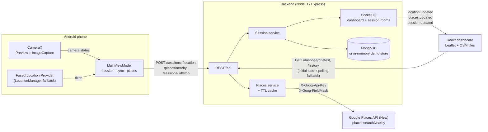
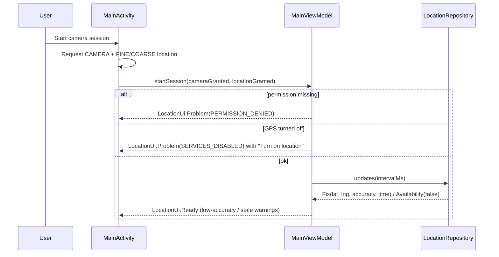
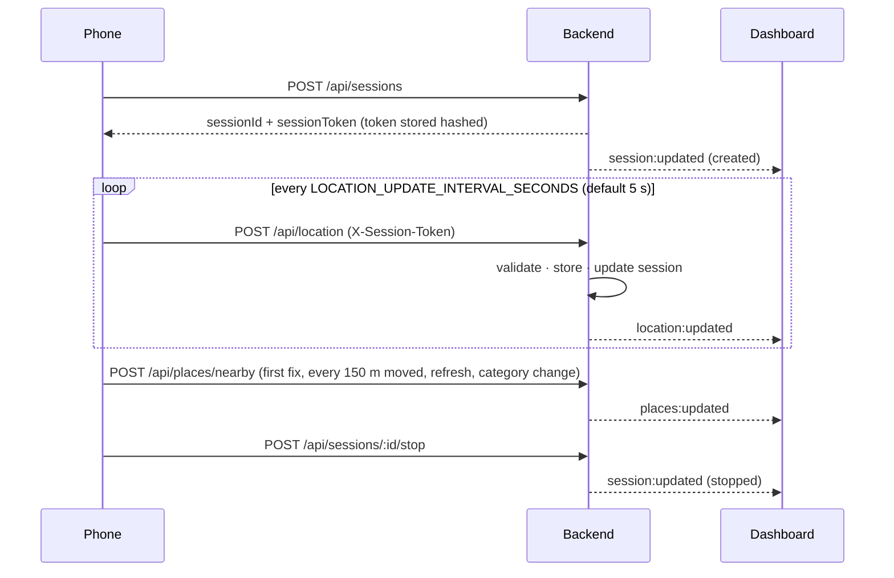
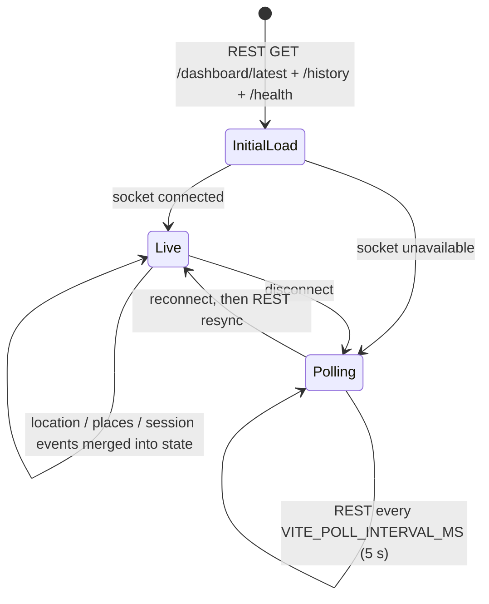

# SmartLens Architecture

SmartLens has three parts:

- **Android app** (`mobile/`): Kotlin, CameraX, Fused Location Provider, Retrofit, coroutines.
- **Backend** (`backend/`): Node.js, Express 5, Mongoose, Socket.IO.
- **Web dashboard** (`web/`): React, Vite, TypeScript, Leaflet, Socket.IO client.

By default the camera preview never leaves the phone, and only coordinates, accuracy, and a camera on/off flag are sent to the backend. The optional **live view** (below) shares low-resolution preview frames only while the phone user turns it on.

## System overview

## Camera architecture

- `CameraController` gets a `ProcessCameraProvider` and binds a `Preview` and an `ImageCapture` use case to the Activity lifecycle with `bindToLifecycle`. It uses the back camera, falling back to the front camera.
- Because the camera is bound to the lifecycle, CameraX closes it when the Activity stops and reopens it when the Activity starts. No manual pause/resume code is needed, and the camera is never held in the background.
- `cameraInfo.cameraState` is observed and mapped to `STARTING / ACTIVE / PAUSED / ERROR`. Errors such as "camera in use" or "disabled by policy" are shown in the preview card with a Retry button.
- If camera permission is denied, the session still runs in location-only mode and reports `cameraActive: false`. The app does not crash.
- Photo capture saves a JPEG only on the device (`Pictures/SmartLens` on Android 10+, otherwise the app's own Pictures folder). Photos are never uploaded.

### Live view (opt-in)

- A third CameraX use case, `ImageAnalysis`, runs at 640×480 in YUV format and keeps only the latest image. The preview requests a 30 fps sensor rate, because auto-exposure otherwise drops to about 10 fps indoors.
- While **Share live view** is on and a session runs, at most one frame every 66 ms (about 15 fps) is converted from YUV to NV21 and JPEG-encoded by the platform's native encoder, which takes about 12–20 ms on a Galaxy M15. Frames are **not** rotated on the phone; the rotation travels in `X-Frame-Rotation` and the viewer applies it.
- `MainViewModel.onLiveFrame` keeps up to 4 uploads in flight and drops (never queues) anything beyond that. Each frame carries an increasing `X-Frame-Seq`, and the backend ignores a frame that arrives after a newer one. UI stats refresh twice a second, so the phone's own preview stays smooth. Frames are sent only while the app is in the foreground.
- The backend checks the session token, the JPEG signature, the sequence and the rotation. It keeps only the newest frame in a bounded in-memory map and relays it as a volatile `camera:frame` Socket.IO event. Nothing is persisted, and the frame is removed when the session ends.
- The dashboard does **not** put frames into React state. `useDashboard` hands them to subscribers, and the Live camera view decodes each one off the main thread (`createImageBitmap`), drops late decodes, and draws it rotated and letterboxed onto a canvas. Only a small stats line re-renders, twice a second.
- Measured on a Galaxy M15 over USB (`adb reverse`), in a dim room: the camera delivered 14 fps, encoding took 19 ms per frame, the dashboard received 11.9 fps, and the canvas painted 11.5 fps. This is a frame relay, not a video codec; WebRTC would be the next step for higher frame rates over weak networks.

## Location acquisition flow

- The Fused Location Provider is used when Google Play services are available. Otherwise the app uses the platform `LocationManager` (GPS + network providers).
- High-accuracy priority requires fine permission. With coarse permission only, balanced priority is used and the UI shows an **APPROXIMATE** badge.
- **No hardcoded fallback.** If no fix is available, the UI says so. Demo coordinates are used only when the user turns on *Use demo location (emulator)* in Settings. Those coordinates are labelled **DEMO LOCATION** in the app and sent with `source: "demo"`, so the dashboard labels them as simulated.
- Updates run only while the Activity is visible. `onStop` cancels them, and no background location permission is requested.

## Mobile-to-backend data flow

- **Throttling:** location is sent at most once per interval. An extra update is sent when the camera status changes, for example when the app goes to the background and reports `cameraActive: false`.
- **Resilience:** if the backend is unreachable, the camera and location keep working locally, and session creation is retried every 10 s. If the backend replies `SESSION_NOT_FOUND`, `SESSION_INACTIVE`, or a token error (for example after a restart in in-memory mode), the app creates a new session on its next update.
- **Timeouts:** the server marks a session `inactive` with `endedReason: "timeout"` after `SESSION_TIMEOUT_SECONDS` without updates. The next update from that phone reactivates it. A session the user stopped is never reactivated.

## External Places API flow

1. The phone sends coordinates to the backend. The Google key exists only in `backend/.env`.
2. `placesService` picks a provider from `PLACES_PROVIDER`: by default Google if `GOOGLE_PLACES_API_KEY` is set, otherwise OpenStreetMap through the public Overpass API (`osmPlacesClient.js`); `demo` gives simulated places.
3. `googlePlacesClient` POSTs to `https://places.googleapis.com/v1/places:searchNearby` with these settings:
   - Headers `X-Goog-Api-Key` and `X-Goog-FieldMask`. The mask requests only id, display name, address, location, types, primary type and display name, Maps URI, and business status.
   - `locationRestriction.circle`, `rankPreference: DISTANCE`, `maxResultCount ≤ 20`, and `includedTypes` from the category allow-list.
   - An abort timeout of `PLACES_TIMEOUT_MS`.
4. Responses are normalized to `{ id, name, category, types, address, latitude, longitude, distanceMeters, mapsUri, businessStatus, source, simulated }` and sorted by haversine distance.
5. HTTP errors are mapped to `PLACES_*` codes (see [API.md](API.md)). Failures return errors; simulated results are never substituted.
6. Identical requests (coordinates rounded to about 11 m, plus radius and category) are cached in memory for `PLACES_CACHE_TTL_SECONDS` (default 5 minutes). Per-session snapshots live for 30 minutes (MongoDB TTL index). This short-lived caching is meant to stay within Google's terms, which allow only temporary caching of Places content. The dashboard shows "Places data © Google" attribution.

## Database role

| Collection | Contents | Indexes |
|---|---|---|
| `sessions` | session ID, **hash** of the write token, status, end reason, camera flag, device name, source, simulated flag, last location, counters | unique `sessionId`; `lastSeenAt`; `status + lastSeenAt` |
| `locationupdates` | one document per accepted update: coordinates, accuracy, camera flag, source, client timestamp, server `receivedAt` | `sessionId + receivedAt`; TTL on `receivedAt` (`LOCATION_RETENTION_HOURS`) |
| `placesnapshots` | latest nearby result per session | unique `sessionId`; TTL on `expiresAt` |

Camera frames and photos are never stored.

**Fallback:** if MongoDB is not configured or not reachable at startup and `DEMO_MODE=true`, the server uses `memoryStore`. This store has the same interface but is temporary and bounded (200 sessions, 500 updates per session). The fallback is reported in `/api/health` (`storage: "memory"`, `persistent: false`), in every response's `meta.storage`, and on the dashboard ("Temporary storage"). With `DEMO_MODE=false`, the server refuses to start without MongoDB.

## Web dashboard synchronisation

- `useDashboard` holds the state in a reducer. Socket listeners are registered once per connection and removed in the effect cleanup, so no duplicate listeners or leaks occur.
- On every (re)connect, the dashboard refetches over REST to fill any gap.
- While the socket is connected, a slow 60 s REST refresh acts as a safety net. While it is disconnected, REST polling runs every 5 s.
- Connection badges show only observed state. **Live** appears only after a Socket.IO `connect`, **Polling** while it is down, and **Backend offline** after a failed REST call.
- By default the dashboard follows the latest active session. It switches only when the session shown is no longer active, so two active phones do not make it flip back and forth. A specific session can be pinned from the history list.

## REST vs WebSocket

| | REST | Socket.IO |
|---|---|---|
| Used for | All writes from the phone; the dashboard's initial load, history, polling fallback, and demo control | Server-to-dashboard push of changes |
| Why | Simple, stateless, easy to validate, rate-limit, and test; works through any network | Low-latency updates without polling; rooms limit who receives location data |
| Failure mode | Error envelope, with retries handled by clients | Automatic reconnection, plus REST polling meanwhile |

The phone uses only REST. A mobile app sending one small update every few seconds does not need a persistent socket, and REST copes better with flaky mobile networks.

## Demo mode vs live mode

| Aspect | Demo (`DEMO_MODE=true`, no key) | Live |
|---|---|---|
| Nearby places | Real OpenStreetMap places (no key); with `PLACES_PROVIDER=demo`, 16 fictional places named "(Demo)", `simulated: true` | Google Places API (New), or OpenStreetMap |
| Storage | MongoDB if reachable, otherwise temporary memory | MongoDB required when `DEMO_MODE=false` |
| Dashboard simulator | **Run demo simulation** button drives a simulated session | Disabled |
| Phone location | Real GPS, or the explicitly enabled demo location | Real GPS |
| Labelling | `meta.mode: "demo"`, DEMO badges in the app and on the dashboard | `meta.mode: "live"` |

`DEMO_MODE=true` together with a Google key is a valid combination: places are live, and the memory fallback and simulator stay available.

The camera preview behaves the same in both modes, because it is independent of any demo data.

## Limits of the approach

Nearby-place discovery uses the phone's GPS position and a radius. It **does not identify the object or building visible in the camera**. Image recognition and AR overlays (for example using compass heading or ARCore) are possible future extensions that are not implemented.
